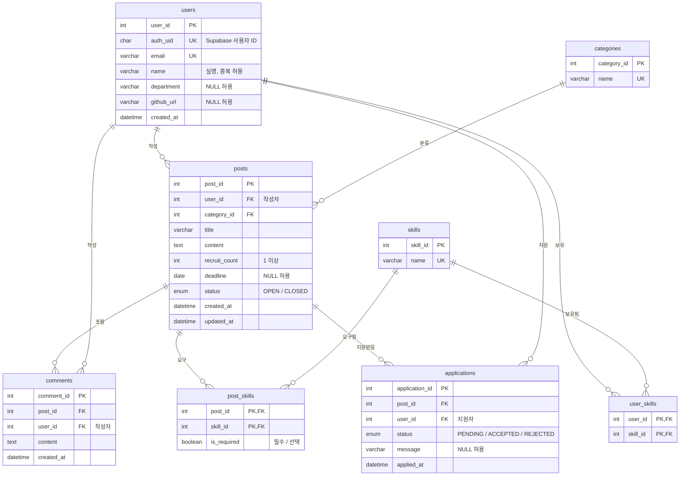

# 🗂️ ERD 설계 (Entity-Relationship Design)

* 작성일: 2026-11-09
* 요구사항 번호(R1 ~ R22)는 [`requirements.md`](requirements.md)를 따른다.
* 데이터베이스: MySQL (`campus_matcher`, `utf8mb4`)

---

## 1. ERD

---

## 2. 관계 정리

| 관계 | 종류 | 구현 방법 | 관련 요구사항 |
|---|---|---|---|
| 사용자 – 게시글 (작성) | 1 : N | `posts.user_id` FK | R5, R9 |
| 카테고리 – 게시글 | 1 : N | `posts.category_id` FK (NOT NULL) | R5, R12 |
| 게시글 – 댓글 | 1 : N | `comments.post_id` FK | R13, R14 |
| 사용자 – 댓글 (작성) | 1 : N | `comments.user_id` FK | R13, R14 |
| 사용자 – 기술 스택 | **M : N** | 중간 테이블 `user_skills` | R3, R15 |
| 게시글 – 기술 스택 | **M : N** | 중간 테이블 `post_skills` (관계 속성 `is_required`) | R6, R12 |
| 사용자 – 게시글 (지원) | **M : N** | 중간 테이블 `applications` (관계 속성 `status`, `message`) | R16 ~ R22 |

* 다대다 관계 3개는 모두 중간 테이블로 분해하였다.
* 그중 `post_skills`와 `applications`는 **관계 자체가 속성을 가지는** 경우로, 해당 속성은 어느 한쪽 엔티티가 아니라 관계에 종속된다.

---

## 3. 테이블 상세

### (1) `users` — 회원
| 컬럼 | 타입 | 제약조건 | 설명 |
|---|---|---|---|
| user_id | INT | PK, AUTO_INCREMENT | 내부 식별자 |
| auth_uid | CHAR(36) | NOT NULL, UNIQUE | Supabase 사용자 ID (UUID) |
| email | VARCHAR(255) | NOT NULL, UNIQUE | 교내 이메일 (`@seoultech.ac.kr`) |
| name | VARCHAR(50) | NOT NULL | 실명 (중복 허용) |
| department | VARCHAR(50) | NULL | 학과 |
| github_url | VARCHAR(255) | NULL | GitHub 프로필 주소 |
| created_at | DATETIME | NOT NULL, DEFAULT CURRENT_TIMESTAMP | 가입일 |

### (2) `categories` — 게시글 카테고리
| 컬럼 | 타입 | 제약조건 | 설명 |
|---|---|---|---|
| category_id | INT | PK, AUTO_INCREMENT | |
| name | VARCHAR(30) | NOT NULL, UNIQUE | 공모전 / 스터디 / 팀 프로젝트 |

### (3) `skills` — 기술 스택
| 컬럼 | 타입 | 제약조건 | 설명 |
|---|---|---|---|
| skill_id | INT | PK, AUTO_INCREMENT | |
| name | VARCHAR(50) | NOT NULL, UNIQUE | 예: Java, React, MySQL (목록은 추후 확정, `seed.sql`로 관리) |

### (4) `user_skills` — 사용자 보유 기술 (M:N)
| 컬럼 | 타입 | 제약조건 | 설명 |
|---|---|---|---|
| user_id | INT | PK, FK → users | |
| skill_id | INT | PK, FK → skills | |

### (5) `posts` — 모집 게시글
| 컬럼 | 타입 | 제약조건 | 설명 |
|---|---|---|---|
| post_id | INT | PK, AUTO_INCREMENT | |
| user_id | INT | NOT NULL, FK → users | 작성자 |
| category_id | INT | NOT NULL, FK → categories | |
| title | VARCHAR(100) | NOT NULL | 제목 |
| content | TEXT | NOT NULL | 내용 |
| recruit_count | INT | NOT NULL, CHECK (≥ 1) | 모집 인원 |
| deadline | DATE | NULL | 모집 마감일 |
| status | ENUM('OPEN', 'CLOSED') | NOT NULL, DEFAULT 'OPEN' | 모집중 / 모집완료 |
| created_at | DATETIME | NOT NULL, DEFAULT CURRENT_TIMESTAMP | |
| updated_at | DATETIME | NOT NULL, DEFAULT CURRENT_TIMESTAMP ON UPDATE CURRENT_TIMESTAMP | |

### (6) `post_skills` — 게시글 요구 기술 (M:N)
| 컬럼 | 타입 | 제약조건 | 설명 |
|---|---|---|---|
| post_id | INT | PK, FK → posts (ON DELETE CASCADE) | |
| skill_id | INT | PK, FK → skills | |
| is_required | BOOLEAN | NOT NULL, DEFAULT TRUE | TRUE: 필수, FALSE: 선택 |

### (7) `comments` — 댓글
| 컬럼 | 타입 | 제약조건 | 설명 |
|---|---|---|---|
| comment_id | INT | PK, AUTO_INCREMENT | |
| post_id | INT | NOT NULL, FK → posts (ON DELETE CASCADE) | |
| user_id | INT | NOT NULL, FK → users | 작성자 |
| content | TEXT | NOT NULL | |
| created_at | DATETIME | NOT NULL, DEFAULT CURRENT_TIMESTAMP | |

### (8) `applications` — 지원 내역 (M:N)
| 컬럼 | 타입 | 제약조건 | 설명 |
|---|---|---|---|
| application_id | INT | PK, AUTO_INCREMENT | |
| post_id | INT | NOT NULL, FK → posts (ON DELETE CASCADE) | |
| user_id | INT | NOT NULL, FK → users | 지원자 |
| status | ENUM('PENDING', 'ACCEPTED', 'REJECTED') | NOT NULL, DEFAULT 'PENDING' | 대기 / 수락 / 거절 |
| message | VARCHAR(300) | NULL | 지원 메시지 |
| applied_at | DATETIME | NOT NULL, DEFAULT CURRENT_TIMESTAMP | |
| | | UNIQUE (post_id, user_id) | 중복 지원 방지 |

---

## 4. 설계 결정 사항

| 항목 | 결정 | 근거 |
|---|---|---|
| 게시글 삭제 시 하위 데이터 | `post_skills`, `comments`, `applications`에 `ON DELETE CASCADE` 적용 | R10. 게시글 없이 남을 이유가 없는 데이터 |
| 회원 삭제 | 기능을 제공하지 않으므로 `users` 참조 FK는 기본값(RESTRICT) 유지 | 제외 범위(회원 탈퇴) |
| 기술 스택·카테고리 삭제 | 기본값(RESTRICT) 유지 | 사용 중인 항목이 실수로 삭제되는 것을 방지 |
| 상태값 표기 | ENUM 값은 영문 코드(`OPEN`, `PENDING` 등)로 저장하고 화면에서 한글로 표시 | 코드 비교 시 오타·인코딩 문제 방지 |
| 지원 취소 | 별도 상태값 없이 해당 지원 행을 삭제 (대기 상태일 때만, 서버에서 검사) | R22. 상태값을 3개로 단순하게 유지 |
| 기술 스택 목록 | `skills`는 `seed.sql`로 미리 등록한 항목만 사용하며, 사용자가 추가하는 기능은 제공하지 않음. 분야별 분류 없음 | 표기 불일치 방지, MVP 범위 유지 |
| 기술 스택 저장 방식 | 기술 이름은 `skills`에만 한 번 저장하고, `user_skills`·`post_skills`는 `skill_id`(번호)로만 참조 | 이름 변경 시 한 곳만 수정, 중복 저장 방지 |
| 생성 시각 컬럼 | 주요 테이블에 생성 시각(`created_at`, `applied_at`)을 `DEFAULT CURRENT_TIMESTAMP`로 자동 기록 | 기록·정렬·디버깅 용도, 추가 비용이 거의 없음 |
| 비밀번호·인증번호 | MySQL에 저장하지 않음 | Supabase Auth가 관리 |
| Supabase 연결 | `users.auth_uid`로만 연결하고, 다른 테이블은 `users.user_id`(INT)를 참조 | 외부 서비스 의존 범위 최소화 |
